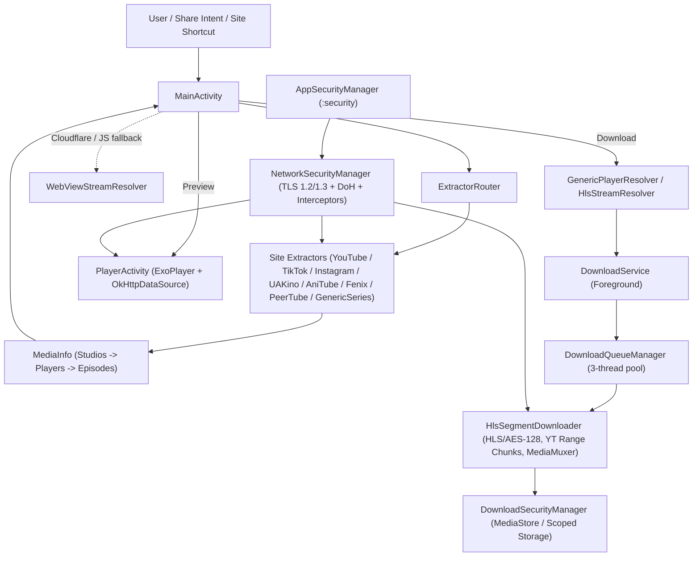

# AniUA Downloader — Project Structure, Architecture & Security/Bug Audit

## 1. What This Project Is About

**AniUA Downloader** is a native **100% Kotlin Android application** (API 24+ / targetSdk 34) for discovering, analyzing, streaming, and downloading anime, TV series, movies, and social media videos.

### Core Capabilities
- **Multi-Source Media Extraction (`ua.aniua.downloader.extractor`)**:
  - **Ukrainian Anime & Cinema Sites**: `AniTube`, `UAKino` (DLE AJAX playlists, RalodePlayer, iframe embeds).
  - **Video Balancers & Players**: `Fenix Player` (Playback API + JWT + fMP4), `Ashdi`, `Tortuga`, `MoonAnime` / `MoonCDN` (two-stage XOR decoding + Ticket API), `PeerTube` (REST API v1), `Sibnet`, `PlayerJS`, `VidSrc.buzz`, `2Embed`, `MultiEmbed`.
  - **Social & Video Platforms**: `YouTube` (Innertube multi-client API: VisionOS, Android VR, iOS, Android + WebView MWEB PO-token rescue + 2K/4K VP9/AV1 adaptive streams), `TikTok` (watermark-free via TikMate/TikWM/WebView/oEmbed), `Instagram` (Reels/Posts via Web API, Embed HTML, and GraphQL).
  - **Universal Series/Web Extractor (`GenericSeriesExtractor`)**: Parses JSON-LD, `__NEXT_DATA__`, PlayerJS JSON playlists, DOM episode lists, WordPress AJAX season switchers, CMS AJAX endpoints, and enriches metadata via TVMaze / Jikan APIs.
  - **Headless & Built-in WebView Browser (`WebViewStreamResolver`, `MainActivity`)**: Site shortcuts bar with built-in WebView browser for Cloudflare-protected sites and dynamic `.m3u8`/`.mp4` interception.
- **High-Speed Video Downloader (`ua.aniua.downloader.service`)**:
  - Background foreground `DownloadService` + `DownloadQueueManager` (3 concurrent workers).
  - `HlsSegmentDownloader`: downloads MPEG-TS / fMP4 (`#EXT-X-MAP`) HLS streams with AES-128 CBC decryption, multi-threaded 2 MB Range-chunk downloading for YouTube (`googlevideo.com`), and hardware `MediaMuxer` muxing of split audio/video streams (MP4 & WebM).
  - Scoped Storage (`MediaStore` on Android 10+) and guarded app-private fallback on older Android versions.
- **Built-in Media Player (`PlayerActivity`, `OkHttpDataSource`)**:
  - Powered by **AndroidX Media3 ExoPlayer (1.3.1)** over the app's hardened `OkHttpClient` (DNS-over-HTTPS, HTTP/2, custom headers), with automatic quality fallback and WebView player fallback.
- **Dedicated Security Module (`:security`)**:
  - Android KeyStore AES-256-GCM cryptography (`KeystoreCryptoManager`) + `EncryptedSharedPreferences` (`SecureStorageManager`).
  - Runtime threat detection (`AppSecurityManager`): Root, Emulator, Anti-Debug/Frida/Xposed, and APK Integrity checks.
  - Hardened `OkHttpClient` (`NetworkSecurityManager`): TLS 1.2/1.3 only, Cloudflare/Google DNS-over-HTTPS, strict HTTPS `network_security_config.xml`, header/token leakage prevention (`SecurityHeadersInterceptor`), tamper blocking (`TamperDetectionInterceptor`).
  - Path traversal protection & filename sanitization (`DownloadSecurityManager`).

### Technology Stack
| Layer | Technologies |
|---|---|
| Language | Kotlin 1.9.24, Coroutines 1.8.0 (JVM 17) |
| Build | Android Gradle Plugin 8.4.1, Gradle 9.6.0, ViewBinding, R8/ProGuard |
| UI | Material 3 (`Theme.Material3.Light.NoActionBar`, warm Vanilla Cream palette), RecyclerView, SwipeRefreshLayout, Glide 4.16.0 |
| Networking & Parsing | OkHttp 4.12.0, OkHttp DNS-over-HTTPS, Jsoup 1.17.2, Gson 2.10.1 |
| Playback & Muxing | AndroidX Media3 ExoPlayer 1.3.1 (HLS + Progressive + MergingMediaSource), Android `MediaExtractor` / `MediaMuxer` |
| Security | AndroidX Security Crypto (`1.1.0-alpha06`), AndroidKeyStore (StrongBox/TEE), Network Security Config |

---

## 2. Project Structure

```text
AniUaDownloader/
├── build.gradle                              # Root Gradle plugin definitions (AGP 8.4.1, Kotlin 1.9.24)
├── settings.gradle                           # Multi-module config (:app, :security) & repositories
├── gradle.properties                         # JVM args, AndroidX flags (Note: contains local java.home path)
├── .github/workflows/build.yml               # GitHub Actions CI: builds & uploads Debug APK
├── README.md                                 # Project overview (Ukrainian)
├── structere.md                              # This architecture & security/bug audit document
├── LICENSE                                   # MIT License
│
├── app/                                      # Main Android application module (ua.aniua.downloader)
│   ├── build.gradle                          # App config (minSdk 24, targetSdk 34, dependencies, R8)
│   ├── proguard-rules.pro                    # App-level R8 obfuscation & keep rules
│   └── src/
│       ├── main/
│       │   ├── AndroidManifest.xml           # Permissions, Activities (Main, Downloads, Player), DownloadService
│       │   ├── java/ua/aniua/downloader/
│       │   │   ├── AniUaApp.kt               # Application entry point; initializes AppSecurityManager & NetworkSecurityManager
│       │   │   ├── data/
│       │   │   │   └── ShortcutRepository.kt # Persists user site shortcuts in SharedPreferences + URL validation
│       │   │   ├── model/
│       │   │   │   ├── MediaInfo.kt          # Parsed title/poster/description/rating/studios/qualities
│       │   │   │   ├── DubStudio.kt          # Dubbing studio / season grouping
│       │   │   │   ├── PlayerSource.kt       # Video player source (Ashdi, Fenix, Moon, etc.)
│       │   │   │   ├── EpisodeItem.kt        # Episode metadata & embed/stream URL
│       │   │   │   ├── StreamQuality.kt      # Resolved playable/downloadable stream (URL, audioUrl, headers, HLS flag)
│       │   │   │   ├── DownloadTask.kt       # Serializable download job state & progress
│       │   │   │   ├── DownloadState.kt      # Enum: PENDING, DOWNLOADING, PAUSED, COMPLETED, ERROR, CANCELLED
│       │   │   │   └── SiteShortcut.kt       # User-saved site shortcut item
│       │   │   ├── extractor/
│       │   │   │   ├── ExtractorRouter.kt    # Central URL dispatcher to site-specific or generic extractors
│       │   │   │   ├── ExtractorUtils.kt     # Shared helpers: headers, cookies, URL/quality normalization, stream selection
│       │   │   │   ├── AnitubeExtractor.kt   # AniTube scraper (DLE, Ralode, ratings, iframes)
│       │   │   │   ├── UaKinoExtractor.kt    # UAKino scraper (DLE, Ashdi serials, tabs, iframes, JS)
│       │   │   │   ├── DlePlaylistParser.kt  # DataLife Engine AJAX playlist parser
│       │   │   │   ├── RalodePlayerParser.kt # RalodePlayer.init(...) JS parser
│       │   │   │   ├── AshdiExtractor.kt     # Ashdi player & serial JSON extractor
│       │   │   │   ├── TortugaExtractor.kt   # Tortuga player extractor (Base64/reversed decoding)
│       │   │   │   ├── MoonAnimeExtractor.kt # MoonAnime/MoonCDN 2-stage XOR decoder & Ticket API resolver
│       │   │   │   ├── FenixExtractor.kt     # Fenix Playback API + JWT media token + fMP4 HLS extractor
│       │   │   │   ├── PeerTubeExtractor.kt  # PeerTube REST API v1 & JSON-LD fallback extractor
│       │   │   │   ├── PlayerJsDecoder.kt    # PlayerJS encoded string & multi-quality bracket parser
│       │   │   │   ├── HlsStreamResolver.kt  # HLS master playlist (.m3u8) parser & variant selector
│       │   │   │   ├── YouTubeExtractor.kt   # YouTube Innertube API (VisionOS/VR/iOS/Android/MWEB) + stream cache
│       │   │   │   ├── TikTokExtractor.kt    # TikTok extractor (TikMate, TikWM, preloaded HTML, oEmbed)
│       │   │   │   ├── InstagramExtractor.kt # Instagram Reels/Posts extractor (Web API, Embed, GraphQL)
│       │   │   │   ├── GenericPlayerResolver.kt # Universal iframe, packed JS, atob, VidSrc.buzz, CMS AJAX resolver
│       │   │   │   ├── GenericSeriesExtractor.kt # Universal series page parser (LD+JSON, NEXT_DATA, DOM, TVMaze, Jikan)
│       │   │   │   └── WebViewStreamResolver.kt # Headless WebView renderer, media interceptor & YT PO-token extractor
│       │   │   ├── player/
│       │   │   │   └── OkHttpDataSource.kt   # Custom Media3 HttpDataSource backed by app's OkHttpClient
│       │   │   ├── service/
│       │   │   │   ├── DownloadService.kt    # Foreground dataSync service with progress notifications
│       │   │   │   ├── DownloadQueueManager.kt # Thread-pool queue manager (3 workers), listeners & MediaStore output
│       │   │   │   └── HlsSegmentDownloader.kt # HLS/AES-128, parallel YT range chunks, MediaMuxer audio+video muxing
│       │   │   └── ui/
│       │   │       ├── MainActivity.kt       # URL analyzer, shortcuts, built-in WebView browser, episode picker
│       │   │       ├── DownloadsActivity.kt  # Download queue screen (progress, cancel, retry, play, clear)
│       │   │       ├── PlayerActivity.kt     # Fullscreen landscape ExoPlayer + WebView fallback player
│       │   │       └── adapter/
│       │   │           ├── EpisodeAdapter.kt   # Episode list RecyclerView adapter with batch selection
│       │   │           ├── DownloadsAdapter.kt # Active/finished downloads list adapter
│       │   │           └── ShortcutAdapter.kt  # Horizontal site shortcuts strip adapter
│       │   └── res/
│       │       ├── layout/                   # 9 XML layouts (activities, items, dialog)
│       │       ├── drawable/                 # Vector icons & pill/badge backgrounds
│       │       ├── color/                    # Chip selector states
│       │       ├── values/                   # colors.xml, strings.xml (Ukrainian), themes.xml
│       │       └── xml/network_security_config.xml # Strict HTTPS-only, system CAs, API cert pins
│       └── test/java/ua/aniua/downloader/
│           ├── data/ShortcutRepositoryTest.kt
│           ├── extractor/PlayerExtractorsTest.kt
│           └── security/SecurityHardeningTest.kt
│
└── security/                                 # Reusable security library module (ua.security)
    ├── build.gradle                          # Library config (minSdk 24, targetSdk 34)
    ├── proguard-rules.pro                    # Library R8 rules
    ├── consumer-rules.pro                    # Consumer R8 rules
    └── src/main/
        ├── AndroidManifest.xml               # Cleartext disabled, allowBackup=false
        ├── res/xml/network_security_config.xml
        └── java/ua/security/
            ├── crypto/
            │   ├── KeystoreCryptoManager.kt  # AndroidKeyStore AES-256-GCM (StrongBox -> TEE fallback)
            │   └── SecureStorageManager.kt   # EncryptedSharedPreferences + emergency wipe
            ├── hardening/
            │   ├── AppSecurityManager.kt     # Orchestrates audits, periodic monitor & wipe callbacks
            │   ├── AntiDebugAndHookDetector.kt # Debugger, TracerPid, Frida ports/maps/threads, Xposed/LSPosed
            │   ├── RootDetector.kt           # su binaries, Magisk/KSU/APatch paths, root packages, mounts
            │   ├── EmulatorDetector.kt       # Build props, QEMU/VBox files, telephony, sensors
            │   ├── IntegrityDetector.kt      # Package name, APK signature SHA-256, base APK file check
            │   ├── ObfuscatedSecrets.kt      # XOR-masked package name & optional release cert SHA-256 pin
            │   ├── SecurityAuditResult.kt    # Audit result data class & threat-level calculation
            │   ├── SecurityListener.kt       # Callback interface for threats & emergency wipe
            │   └── ThreatLevel.kt            # Enum: CLEAN, ENVIRONMENT_RISK, CRITICAL_ATTACK
            ├── network/
            │   ├── NetworkSecurityManager.kt # Hardened OkHttpClient (TLS 1.2+, DoH, cert pinning, 25MB cache)
            │   ├── SecurityHeadersInterceptor.kt # Safe UA, balancer Referers, strips Auth headers for 3rd-party hosts
            │   └── TamperDetectionInterceptor.kt # Blocks network traffic on CRITICAL_ATTACK (non-debug)
            └── storage/
                └── DownloadSecurityManager.kt # Unicode NFKC filename sanitization, path traversal checks, MediaStore
```

---

## 3. Architecture & Data Flow



---

## 4. Backdoor & Malware Audit

A full line-by-line review of all Kotlin source files, Gradle build scripts, AndroidManifest files, ProGuard configs, XML resources, and GitHub Actions workflow was performed.

### Verdict: **No Malicious Backdoor Found**
- No command-and-control (C2) servers, reverse shells, hidden `Runtime.exec` / `ProcessBuilder` payloads, or dynamic DEX/code loaders (`DexClassLoader`) exist in the repository.
- No sensitive user-data permissions (Contacts, SMS, Call Logs, Camera, Microphone, Location, Accessibility, Install Packages) are requested.
- No `addJavascriptInterface` bridges are exposed to untrusted WebViews.
- `android:allowBackup="false"` and `cleartextTrafficPermitted="false"` are properly set across both modules.

### Privacy & Operational Disclosures (Not Backdoors, Worth Knowing)
1. **Third-Party TikTok APIs (`TikTokExtractor.kt`)**: Pasted TikTok URLs are forwarded to `https://api.tikmate.app/api/lookup` and `https://www.tikwm.com/api/` to obtain watermark-free streams.
2. **Third-Party Metadata & Embed Fallbacks (`GenericSeriesExtractor.kt`)**: Series titles/IMDb/TMDB IDs may be queried against `api.tvmaze.com` and `api.jikan.moe`, and embed fallbacks reference `vidsrc.buzz`, `2embed.cc`, `multiembed.mov`, `vidsrc.to`.
3. **Favicon Service (`ShortcutRepository.kt`)**: Saved site shortcut hostnames are sent to `https://www.google.com/s2/favicons` to load icons.
4. **Release Signing Configuration (`app/build.gradle`)**: `release` build type currently uses `signingConfig signingConfigs.debug` (commented `// For demo builds`). Replace with a real release keystore and configure its SHA-256 in `ObfuscatedSecrets.kt` before distributing a production Release APK.
5. **Local Path in `gradle.properties`**: `org.gradle.java.home=C:\\Users\\Shpaklya\\jdk17\\jdk-17.0.12+7` is a machine-specific path and should ideally be moved to environment variables (`JAVA_HOME`) before sharing across machines.

---

## 5. Security Vulnerabilities & Bugs Found and Fixed

### Security Vulnerabilities Fixed

| # | Severity | Location | Issue Found | Fix Applied |
|---|---|---|---|---|
| 1 | **Critical** | `ObfuscatedSecrets.kt`, `IntegrityDetector.kt` | `ENCODED_CERT_SHA256` XORed with `0xCD` decoded to 93 bytes of corrupted non-hex garbage (`R'O@LDO#VV...`). On **every Release APK**, `verifyApkSignature()` failed, triggering `CRITICAL_ATTACK` → `emergencyWipe()` → `Process.killProcess()` + `System.exit(1)` (total self-destruct DoS). | Replaced corrupted bytes with explicit empty/unconfigured state + strict SHA-256 regex validator `isCertPinConfigured()`. `IntegrityDetector` now verifies valid APK signing cert presence when unpinned, and enforces exact pin match once configured. |
| 2 | **High** | `ExtractorUtils.kt`, `WebViewStreamResolver.kt` | **Cross-domain cookie leakage**: `getCookieHeader(streamUrl) ?: getCookieHeader(referer)` sent session/auth cookies belonging to the referer site to completely unrelated third-party CDN domains. | Added `ExtractorUtils.isSameSiteForCookies(target, referer)` so referer cookies are only attached when both URLs share the same host/root domain. |
| 3 | **High** | `PlayerActivity.kt` | WebView fallback set `mixedContentMode = WebSettings.MIXED_CONTENT_ALWAYS_ALLOW`, violating the app's strict HTTPS policy and permitting MITM injection of HTTP scripts inside HTTPS pages. File/content access was also not disabled. | Changed to `MIXED_CONTENT_NEVER_ALLOW` and disabled `allowFileAccess`, `allowContentAccess`, and geolocation. |
| 4 | **High** | `MainActivity.kt`, `WebViewStreamResolver.kt`, `ShortcutRepository.kt` | Built-in and headless WebViews allowed arbitrary URL schemes (`file://`, `content://`, `intent://`, `javascript:`) because `shouldOverrideUrlLoading` returned `false` (or was missing), and `allowFileAccess` / `allowContentAccess` were not explicitly disabled. | Hardened all WebViews (`allowFileAccess = false`, `allowContentAccess = false`, `MIXED_CONTENT_NEVER_ALLOW`, `setGeolocationEnabled(false)`), restricted navigation strictly to `http`/`https`, and blocked dangerous schemes in `ShortcutRepository.normalizeAndValidateUrl` and `MainActivity.openBrowserUrl`. |
| 5 | **High** | `DownloadQueueManager.kt` | `task.quality`, `task.episodeNumber`, and `task.format` (sourced from untrusted web pages) were interpolated directly into output filenames without sanitization, risking **Path Traversal** or invalid MediaStore entries. | Sanitized `quality` and `episodeNumber` via `DownloadSecurityManager.sanitizeFileName(...)` and whitelisted `format` to `mp4`/`mkv`/`webm`. |
| 6 | **Medium** | `KeystoreCryptoManager.kt` | `encrypt()` passed a caller-generated `GCMParameterSpec(iv)` to a key configured with `setRandomizedEncryptionRequired(true)`. Android KeyStore rejects caller-supplied IVs with `InvalidAlgorithmParameterException` on real devices. | Removed caller-supplied IV during `cipher.init(Cipher.ENCRYPT_MODE, secretKey)` and read KeyStore-generated `cipher.iv`; synchronized `getSecretKey()`. |
| 7 | **Medium** | `FenixExtractor.kt`, `DlePlaylistParser.kt`, `InstagramExtractor.kt` | Unvalidated/unencoded path and query parameters (`slug`, `edition`, `newsId`, `xfield`, `userHash`) could cause URL path traversal or parameter injection; GraphQL JSON built via string interpolation. | Validated `slug`/`edition` against `^[a-zA-Z0-9._-]+$`, URL-encoded query/path parameters, and constructed GraphQL JSON using `JsonObject`. |
| 8 | **Low** | `security/AndroidManifest.xml`, `NetworkSecurityManager.kt`, `AppSecurityManager.kt` | Unnecessary `READ_EXTERNAL_STORAGE` permission in `:security`; leaked HTTP `Response` on pinning failure in `DualLayerPinningInterceptor`; `emergencyWipe()` triggered even in Debug builds and non-volatile `securityListener`. | Removed `READ_EXTERNAL_STORAGE`, closed `response` before throwing `SSLPeerUnverifiedException`, marked `securityListener` `@Volatile`, and skipped `emergencyWipe()` in debuggable builds. |

### Functional Bugs, Races & Crash Fixes

| # | Location | Bug Found | Fix Applied |
|---|---|---|---|
| 1 | `WebViewStreamResolver.kt` | Non-thread-safe `var completed` / `var finished` flags accessed from both WebView IO thread (`shouldInterceptRequest`) and Main thread (`onPageFinished` / cancellation) could resume coroutine twice (`IllegalStateException`) or leak WebViews. | Replaced with `AtomicBoolean` and atomic `compareAndSet(false, true)`. |
| 2 | `HlsSegmentDownloader.kt` | **Corrupted output on retries**: If partial bytes were already written to `outputStream` before a failure, retry logic appended the fallback stream onto the same `outputStream`. | Wrapped `outputStream` in `CountingOutputStream`; retries only execute when `bytesWritten == 0L`. |
| 3 | `HlsSegmentDownloader.kt` | **Temp file collision**: Concurrent downloads (3-thread pool) used `System.currentTimeMillis()` for temp muxing files, causing collisions when two tasks started in the same millisecond. | Switched to `File.createTempFile(...)`. |
| 4 | `HlsSegmentDownloader.kt` | **HLS AES-128 bugs**: (a) Single scalar key spec broke playlists with key rotation or `METHOD=NONE`; (b) `decryptAes128()` caught exceptions and silently wrote raw encrypted ciphertext into the video file. | Tracked per-segment `SegmentKeySpec` with URL key cache; decryption failure now throws `IllegalStateException` instead of producing corrupted video. |
| 5 | `HlsSegmentDownloader.kt` | **Infinite loop & thread-pool race**: `downloadDirectRangeStream` could spin forever if server returned 0 bytes on HTTP 206; `downloadDirectToFile` closed `RandomAccessFile` without `pool.awaitTermination(...)`; `muxVideoAndAudio` catch block could append `videoFile` after partial write to `outStream`. | Added 0-byte chunk guard, `pool.awaitTermination(3, SECONDS)` in `finally`, and `startedWritingOutput` flag before mux fallback. |
| 6 | `DownloadQueueManager.kt` | Retrying a task reused the same mutable `DownloadTask` instance while an older worker could still be running, and shallow-copied `headers` risked `ConcurrentModificationException`. | Added `snapshotTask()` with synchronized header copying and cancelled previous cancel tokens on re-enqueue. |
| 7 | `DownloadService.kt` | Foreground service could stay stuck alive forever if started without active tasks (e.g., via retry race). | Added active-count check in `onStartCommand` to cleanly stop foreground service when queue is empty. |
| 8 | `SecureStorageManager.kt` | After `fallbackRecoverPrefs()` deleted corrupted prefs XML, `encryptedPrefs` stayed `null` forever without retrying initialization. | Added single retry after deleting corrupted prefs file. |
| 9 | `OkHttpDataSource.kt` | Closing data source did not cancel active OkHttp `Call`; HTTP 200 responses to ranged seek requests did not skip `dataSpec.position` bytes. | Tracked `@Volatile currentCall` and cancelled on `closeQuietly()`; added `skipFully()` when server returns `200 OK` for `position > 0`. |
| 10 | `MainActivity.kt` | Concurrent `startAnalyze` calls raced and overwrote newer UI state; single-video download opened `DownloadsActivity` before async task enqueue finished; empty-player studio left stale episodes; WebView destroyed while attached to parent. | Added `analyzeJob` cancellation (+ `CancellationException` rethrow), awaited task build before opening `DownloadsActivity`, cleared episodes on empty players, detached WebView before `destroy()`. |
| 11 | `PlayerActivity.kt` | Overlapping `resolveMoreAndStartPlayback()` invocations on rapid errors; duplicate stream queueing; WebView destroyed while attached to parent. | Added `isResolvingNext` guard, `queuedStreamKeys` deduplication, and WebView detachment before `destroy()`. |
| 12 | `MoonAnimeExtractor.kt`, `UaKinoExtractor.kt`, `ExtractorRouter.kt`, `PeerTubeExtractor.kt` | Substring matching hijacked unrelated URLs (e.g., `/moon` matched `example.com/movies/moon-knight`, `uakino`/`anitube` matched query params); `PeerTubeExtractor.parsePage` returned a fake MediaInfo instead of `null` on non-PeerTube `/w/` URLs. | Switched to host-based URL detection and returned `null` from `PeerTubeExtractor.parsePage` when unresolved on non-PeerTube hosts. |
| 13 | `FenixExtractor.kt`, `AshdiExtractor.kt`, `UaKinoExtractor.kt`, `AnitubeExtractor.kt` | Unsafe Gson `.asString`/`.asInt`/`.asJsonObject` calls crashed on `JsonNull` fields; `AnitubeExtractor` and `UaKinoExtractor` did not forward WebView clearance cookies. | Replaced with null-safe Gson primitive checks and added optional WebView cookie forwarding. |
| 14 | `security/proguard-rules.pro` | Outdated method signatures and wrong model package (`ua.aniua.downloader.models.**` instead of `model.**`) risked breaking R8 Release builds. | Updated keep rules to match actual class and method signatures. |
